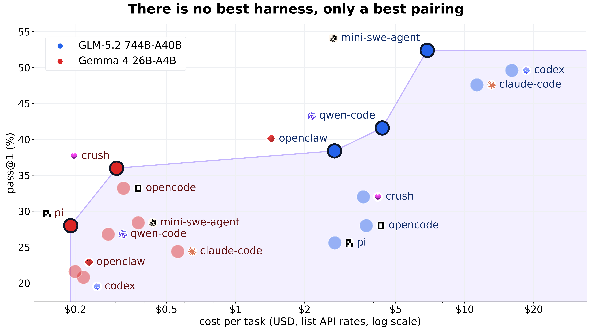

# 多 harness RL 终极指南

Adithya S Kolavi、Joel Niklaus、Sergio Paniego Blanco、Leonie Monigatti、Amine Dirhoussi、Ben Burtenshaw、Lewis Tunstall、Leandro von Werra

原文：https://huggingface.co/spaces/FineEnvs/multi-harness-rl

非官方简体中文译本，正文采用 CC BY 4.0；语言和布局已改编。

<a id="introduction"></a>

## 导论

如果你用 AI 写代码，很可能在不止一种工具里用过同一个模型：例如在 [Claude Code](https://code.claude.com/docs/en/overview)、[Cursor](https://cursor.com)、[Pi](https://pi.dev) 或 [Cline](https://cline.bot) 中使用 Claude。你也可能注意到，它在这些工具里的表现并不相同：规划方式不同，选择的工具不同；在一种工具中能完成的任务，换到另一种工具里可能就会卡住。

这种差异可以测量，来源是包裹在模型周围的程序，也就是 **agent harness（智能体运行框架，下文简称 harness）**。它负责运行循环、决定模型可用的工具、构造模型读取的上下文、解释模型返回的内容，并决定何时停止。更换 harness，就会改变模型看到的信息和获准执行的操作，结果也随之改变。在 SWE-bench Pro 上，[Joel Niklaus 测得](https://x.com/joelniklaus/status/2085725862142623875)，同一个 GLM-5.2 模型在一种 harness 中的得分为 23%，在另一种中为 52%。harness 的排名也不会在不同模型之间保持一致：对 GLM-5.2 而言，Codex 在十种 harness 中排名第二；对 Gemma 4 26B-A4B 而言，却排名第九。

<figure><figcaption>SWE-bench Pro 上，两个模型在不同编码 harness 下的 pass@1 与每任务成本。图作者：<a href="https://x.com/joelniklaus/status/2085725862142623875">Joel Niklaus</a>。图中标签保留原文。</figcaption></figure>

对于自行部署的开放权重模型，harness 的影响尤其明显。如果模型从未在你的 harness 中接受训练，就可能表现不佳：它会调用不存在的工具，或者生成 harness 无法解析的输出。只在一种 harness 中训练也不能彻底解决问题，因为模型会学会这种 harness 的习惯，在其他 harness 中依然遇到困难。

解决办法是直接在这些 harness 内训练模型，针对多步工具使用开展强化学习，这称为 **agentic reinforcement learning（智能体强化学习，agentic RL）**。本研究要回答的问题是：能否拿一个小型开放模型，在人们实际使用的 Claude Code、Codex、OpenCode 等 harness 内这样训练，让它在所有这些 harness 中都得到提升？这些 harness 都按其发布时的方式运行：它们原本并非为训练设计，我们也没有修改它们的代码。本文介绍了一个实现这一目标的开放框架：以 [OpenEnv](https://github.com/huggingface/OpenEnv) 为基础，由 [Harbor](https://harborframework.com/) 提供任务和沙箱，由 [TRL](https://github.com/huggingface/trl) 负责训练。

本文分为两部分。第一部分是指南：先介绍 harness、agentic RL 和 RL 环境的[基础知识](#the-basics)，再结合近期论文和模型报告，解释[为什么模型需要跨 harness 训练](#why-train-across-harnesses)。第二部分介绍我们自己的工作：[框架如何运作](#how-the-framework-works)，以及用它在四种 harness 中同时训练小型开放模型 [LFM2.5-2.6B](https://huggingface.co/LiquidAI/LFM2.5-2.6B) 后的[实验结果](#training-small-models-across-harnesses)。跨四种 harness 训练后，模型在留出任务上的平均解题率由 42% 提升至 54%；对于它原本就能解出的任务，工具调用次数减少了 31%。同一个模型如果只在 OpenCode 中训练，提升主要集中在 OpenCode，在另外三种未经训练的 harness 中提升较小。我们也比较了 RL 与基于更大模型成功 rollout 的**监督微调（SFT）**，后者带来的提升更少。使用 [Qwen3.5-2B](https://huggingface.co/Qwen/Qwen3.5-2B) 的早期实验，放在训练章节的折叠部分中。


<a id="the-basics"></a>

## 基础知识

<a id="what-is-a-harness"></a>

### 什么是 harness？

一篇 2026 年关于基准测试信息披露的立场论文，将 agent harness 定义为：模型与任务之间的软件层，负责构造模型看到的上下文、协调工具调用、验证输出，以及决定何时重试、升级处理或停止 [1](#ref-zhang2026stopcomparing)。对模型来说，harness 是它与任务交互的接口；对训练器来说，它是别人编写、训练器无法修改的程序。

一些相近的术语很容易混淆，本文采用以下含义：

- **策略（policy）**：正在训练的模型，即将提示转换为补全的权重；它本身没有循环，也不会在调用之间保留记忆。本文也直接称其为模型。
- **智能体（agent）**：在 harness 内运行的策略，也就是能够规划、调用工具并决定何时停止的完整程序。
- **沙箱（sandbox）**：实际执行操作的隔离场所，例如容器、虚拟机或 tmux 会话。
- **基准测试（benchmark）**：固定的任务集合，以及用于比较这些任务上结果的评测协议。

Hugging Face 的[智能体术语表](https://huggingface.co/blog/agent-glossary) 对这些概念有更详细的介绍。

模型选择工具及其参数；harness 执行调用，将结果加入模型上下文，再询问模型下一步该做什么。

<figure id="d3-harness-anatomy"><div class="fig-title">harness 的内部结构</div><iframe class="viz-frame" src="webapp/embeds/basics-00.html" title="harness 的内部结构" loading="lazy"></iframe><figcaption>执行循环、工具、沙箱，以及唯一通向外部的模型端点。</figcaption></figure>


<a id="what-is-agentic-rl"></a>

### 什么是 agentic RL？

Agentic RL 是面向多步行动模型的强化学习。动作是工具调用，观测是工具返回结果，奖励来自检查完整轨迹的评分器。一次 rollout 的流程是：编写、运行、读取结果、决定下一步尝试，最终提交可由评分器打分的内容。训练器针对每个任务运行一组这样的 rollout，再根据它们奖励的相对差异进行学习。

<figure id="d3-llm-rl-coding"><div class="fig-title">编码智能体的强化学习流程</div><iframe class="viz-frame" src="webapp/embeds/basics-01.html" title="编码智能体的强化学习流程" loading="lazy"></iframe><figcaption></figcaption></figure>


<a id="what-are-rl-environments"></a>

### 什么是 RL 环境？

**RL 环境**是策略作用于其上的有状态系统。环境接收动作，更新内部状态，返回观测，并在某个时刻返回奖励。因此，环境负责状态、状态转移和奖励，而 harness 负责运行循环。

下图将负责采样、评分和更新的训练循环，与它作用的环境并排展示。

<figure id="d3-anatomy-hero"><div class="fig-title">训练循环与 RL 环境的组成</div><iframe class="viz-frame" src="webapp/embeds/basics-02.html" title="训练循环与 RL 环境的组成" loading="lazy"></iframe><figcaption></figcaption></figure>


环境框中包含任务集、提示模板、工具、观测、执行后端、世界状态、奖励规则和终止条件。各框架未必会为每个部分单独命名。在标为“工具 / Harness”的框里，harness 指工具接口，而非完整的智能体程序。此图和上面的 rollout 图来自[《RL 环境终极指南》](https://huggingface.co/spaces/AdithyaSK/rl-environments-guide)；该文为每个组成部分都提供了示例，可供进一步阅读。

<a id="white-box-vs-black-box-rl-environments"></a>

#### 白盒与黑盒 RL 环境

*究竟是谁驱动 rollout？*

在**白盒**环境中，训练器掌握循环：它采样一个动作，调用 `env.step()`，读取观测，再次采样。环境等待外部调用。策略生成的每个 token 都已经在训练器手里，因为采样本来就是由训练器完成的。前一篇指南比较的六种框架全都采用这种方式；当你向 TRL 的 [`GRPOTrainer`](https://huggingface.co/docs/trl/grpo_trainer) 提供环境工厂时，它也期望这种工作方式。

在**黑盒**环境中，harness 掌握循环：它在沙箱中启动，运行自己的循环、调用自己的工具、压缩自己的上下文，并自行决定何时停止。它是一个原本没有考虑训练用途的智能体程序。训练器位于盒子外部，只能看到到达模型端点的一串调用。

微软的 Agent Lightning 团队为这两种模式作出了区分 [2](#ref-he2026agentlightning)：

> 在传统 agentic RL 中，训练引擎掌握环境交互循环；在由 harness 驱动的 agentic RL 中，harness 掌握这一循环，训练引擎只能观察到一串 LLM 请求—响应对。

不同 harness 的内部实现差异很大，但每一种都必须调用模型；模型 API 是唯一保证存在于 harness 外部的接口。除此之外，harness 和环境的状态对训练器都是隐藏的。

<aside class="note"><strong>“白盒”和“黑盒”的两种用法</strong>

KAT-Coder 报告 [3](#ref-kwaikat2026katcoder) 用这两个术语描述 harness 如何组织轨迹。它将 Mini-SWE-Agent 称为白盒，因为后者循环简单且不压缩轨迹；将 Claude Code、Codex、OpenClaw、OpenHands 称为黑盒，因为它们会压缩并重组上下文。本文区分的是谁掌握 rollout 循环：训练器还是 harness。上下文处理方式与循环的归属，是两个独立的选择。

</aside>

将循环移入 harness 会带来两方面的变化。首先是谁发起每次调用，以及调用的顺序。

<figure id="d3-who-drives"><div class="fig-title">谁发起调用</div><iframe class="viz-frame" src="webapp/embeds/basics-03.html" title="谁发起调用" loading="lazy"></iframe><figcaption>在两种架构中，各次调用分别由谁发起。</figcaption></figure>


其次是训练器最终记录到什么。harness 可以上报并非由训练器触发的事件，但没有义务这样做。下图把同一次 rollout 展示三遍：实际发生的过程，以及两种架构各自记录到的内容。

<figure id="d3-trainer-record"><div class="fig-title">训练器记录到什么</div><iframe class="viz-frame" src="webapp/embeds/basics-04.html" title="训练器记录到什么" loading="lazy"></iframe><figcaption>同一次 rollout 的真实过程，与每种架构留下的记录。</figcaption></figure>


<a id="why-rewards-are-not-enough"></a>

#### 为什么只有奖励还不够

同策略（on-policy）策略梯度 [4](#ref-williams1992reinforce) 需要每个 token 的两项信息：采样到了哪个 token，以及采样时它的概率是多少。只返回文本和分数的 harness，无法提供其中任何一项。

不同的 token 序列可以生成相同的文本。如果只保存文本，再次对其分词，得到的 token ID 可能与模型实际采样的不同。TRL 的[说明文章](https://huggingface.co/blog/huggingface/tito) 说得很直接：RL 优化的对象是模型实际生成的那些精确 token [5](#ref-gallouedec2026tito)。

构造下一个提示时，harness 可能添加角色标记，或者修改工具调用里的空白字符。有些 harness 还会修复格式错误的 JSON。如果训练器从编辑后的文本学习，模型更新所依据的就可能是它从未生成过的响应。

概率也必须在生成时记录。在异步 RL 中，从 rollout 采样完成到训练之间，模型可能已经更新了。用当前权重重新计算 log probability，无法恢复 rollout 当时使用的概率。重要性采样比较的是当前概率与生成时概率；如果分子和分母都使用当前值，即使两种策略不同，比例也会变成 1。

<figure id="d3-token-drift"><div class="fig-title">为什么重新分词只是一种猜测</div><iframe class="viz-frame" src="webapp/embeds/basics-05.html" title="为什么重新分词只是一种猜测" loading="lazy"></iframe><figcaption>相同的字符，可以用两种不同方式分词。</figcaption></figure>


为了避免这两类错误，采样器必须返回 token ID 和逐 token 的对数概率，训练器必须保留它们。不要对已经解码的文本重新编码；应保留采样所得 ID，再通过 ID 拼接追加模板后缀。这能够成立，是因为多数聊天模板在追加工具消息时，可以逐 token 延伸：TRL 文章测试的十九个模型中，十八个无需修改就符合这一条件。这也是需要精确 token 的系统，必须在模型端点进行拦截、而非在文本边界拦截的原因。

其他团队也会从训练器这一侧保留精确 token。例如，Prime Intellect 的 [renderers](https://github.com/PrimeIntellect-ai/renderers) 库将模型的聊天模板转换为 Python 代码，把消息渲染成 token ID，并在扩展多轮 rollout 时不重新渲染模型已采样的部分。它要求训练器掌握循环；其[发布说明](https://www.primeintellect.ai/blog/renderers) 提醒说，修复工具调用或压缩历史的 harness 会破坏这种方式，而采集代理正是为这类情况设计的。

对于 token 级机制是否必不可少，并非所有人意见一致。OpenForgeRL 构建了相同的代理架构，从代理收集的提示—响应对重建训练样本。论文没有提及 token ID 或 log probability，却仍报告了迄今发布的最强多 harness 结果 [6](#ref-yu2026openforgerl)。本文选择忠实保留 token 的路线，但这个问题尚无定论。


<a id="why-train-across-harnesses"></a>

## 为什么要跨 harness 训练

<a id="benchmark-scores-now-come-with-a-harness-attached"></a>

### 基准分数开始附带 harness 信息

模型卡开始说明分数来自哪种 harness。GLM-4.7 声称，在 Claude Code、Kilo Code、Cline、Roo Code 等主流智能体框架中执行复杂任务时，性能显著提升 [7](#ref-zai2025glm47)。Kimi K2 报告了两组 Terminal-Bench [8](#ref-merrill2026terminalbench) 得分：在 Terminus 下为 25.0，在 Moonshot 自有框架下为 30.0 [9](#ref-kimi2025k2)。MiniMax M2 几乎为列出的每个基准都注明了 harness [10](#ref-minimax2025m2card)。DeepSeek-V3.2 的思考模式甚至无法在 Terminus 下运行，因此它的 Terminal-Bench 分数只能来自另一种 harness [11](#ref-deepseek2025v32)。

harness 甚至可以改变模型的领先顺序。[1](#ref-zhang2026stopcomparing) 选取了公开编码排行榜上彼此相差不超过三分的三个模型：GLM-5.1、GPT-5.4、Kimi K2.6。在其余条件固定的情况下，研究者让它们在三种 harness 配置下执行相同的 100 个 SWE-bench Verified [12](#ref-jimenez2024swebench) 任务。三种配置逐步叠加：**Minimal（最简）**使用冗长的工具，不做上下文压缩，也不重试；**Improved（改进）**精简工具，并加入压缩和重试；**Full（完整）**再加入自检、偏移检查和回滚。

<figure id="d3-scaffold-reversal"><div class="fig-title">相同模型、相同任务，三种 harness 配置</div><iframe class="viz-frame" src="webapp/embeds/why-multi-harness-00.html" title="相同模型、相同任务，三种 harness 配置" loading="lazy"></iframe><figcaption>三种模型分别在不同的 harness 配置下取得第一。</figcaption></figure>


每个模型都在一种不同的 harness 下胜出。更换 harness 让 GLM-5.1 的分数变化了 13 个百分点；在相同 harness 内更换模型，分数只变化 2.5 到 5 个百分点。[Joel Niklaus 在 SWE-bench Pro 的十种 harness 上也发现了同样的现象](https://x.com/joelniklaus/status/2085725862142623875)。

在受控实验之外也能看到这一点。同样的 Claude Opus 4.5 权重，在 Scale 的 [SEAL 排行榜](https://labs.scale.com/leaderboard/swe_bench_pro)上取得 45.9% 的 SWE-bench Pro [13](#ref-deng2025swebenchpro) 得分，而在 Claude Code 内取得 55.4% [1](#ref-zhang2026stopcomparing)。

<a id="when-a-model-leaves-the-harness-it-was-trained-in"></a>

### 当模型离开训练时使用的 harness

模型可能在训练时使用的 harness 内表现良好，换到另一种就遇到困难。Orchard 论文测量了这种跨 harness 迁移 [14](#ref-peng2026orchard)。它把两个在一到两种 harness 中训练的开放编码模型，放到三种 harness 下运行，其中包括所有被比较系统在训练时都未用过的 Kimi-CLI。Orchard 自己的模型也参与比较：它先使用 OpenHands 和 Mini-SWE-Agent 的轨迹微调，再在 Mini-SWE-Agent 中进行 RL 训练。

<figure id="d3-harness-lockin"><div class="fig-title">只在一到两种 harness 中训练的代价</div><iframe class="viz-frame" src="webapp/embeds/why-multi-harness-01.html" title="只在一到两种 harness 中训练的代价" loading="lazy"></iframe><figcaption>三个系统分别在三种 harness 下的任务解决率。</figcaption></figure>


将 OpenSWE-32B 从论文视为其原生 harness 的 [OpenHands](https://github.com/OpenHands/OpenHands)，迁移到 [Mini-SWE-Agent](https://github.com/SWE-agent/mini-swe-agent)，分数下降 7.5 个百分点。放到 [Kimi-CLI](https://github.com/MoonshotAI/kimi-cli) 下，SWE-bench Verified 分数下降 58.8 个百分点至 3.6%，Terminal-Bench 2.0 得分为零。Scale-SWE 在原生 harness 之外无法生成有效工具调用。Orchard 的模型则在三种 harness 下，都能保持 45.0 至 64.3 的 SWE-bench Verified 得分。

论文将这些情况分别称为**任务解决率下降**——模型仍能工作，但解出的任务变少；以及**灾难性的格式失败**——模型输出完全无法使用。图中的每一行都是固定的同一个模型，而每个基准在所有 harness 下都使用相同任务，因此下降来自 harness。

<a id="why-models-overfit-to-a-single-harness"></a>

### 为什么模型会对单一 harness 过拟合

KwaiKAT 团队指出了原因 [3](#ref-kwaikat2026katcoder)：

> 在 agentic RL 中，如果训练只依赖一个固定的 harness，模型学到的往往不是“如何解决任务”，而是“如何按照这个特定 harness 的接口约定解决任务”。

他们将其分为三种过拟合：对 harness 的动作**格式**、**上下文结构**以及**控制流**的过拟合。控制流包括模型学会依赖的重试方式和停止条件。

<figure id="d3-overfit-modes"><div class="fig-title">模型对 harness 过拟合的三种方式</div><iframe class="viz-frame" src="webapp/embeds/why-multi-harness-02.html" title="模型对 harness 过拟合的三种方式" loading="lazy"></iframe><figcaption>模型依赖了什么；当这些条件改变时，哪里会失效。</figcaption></figure>


harness 恰好在这些维度上存在差异。它们使用不同的 **API 方言**，即与模型服务器通信时采用的请求和响应格式：OpenAI chat-completions、OpenAI Responses、Anthropic Messages、Google Gemini。它们也在是否使用工具调用、如何压缩上下文，以及替模型接管多少控制流方面存在差异。

<figure id="harness-ecosystem-matrix"><div class="fig-title">harness 生态概览</div><iframe class="viz-frame" src="webapp/embeds/why-multi-harness-03.html" title="harness 生态概览" loading="lazy"></iframe><figcaption>每种 harness 使用哪些模型 API。悬停可查看开发者及其特点。</figcaption></figure>


Mini-SWE-Agent 的 [README](https://github.com/SWE-agent/mini-swe-agent) 将避免 scaffold 过拟合列为采用简单设计的原因之一。[Aider](https://aider.chat/) 使用另一种接口：它要求模型在普通文本中编写[编辑块](https://aider.chat/docs/more/edit-formats.html)，而非结构化工具调用。受过工具调用训练的模型，也必须学习这种输出格式。

实践中，这类失败往往直接表现为报错，而非分数下降。模型会使用训练时 harness 的工具名称和参数名称发起调用；如果新 harness 的命名不同，调用还没真正执行就会被拒绝。

<figure id="d3-format-mismatch"><div class="fig-title">harness 过拟合的实际表现</div><iframe class="viz-frame" src="webapp/embeds/why-multi-harness-04.html" title="harness 过拟合的实际表现" loading="lazy"></iframe><figcaption>同一个工具调用，在训练时的 harness 中被接受，在未见过的 harness 中被拒绝。</figcaption></figure>


harness 的数量还在增长。[Harbor 0.22.0](https://github.com/harbor-framework/harbor/releases/tag/v0.22.0) 提供了四十多种 harness 的适配器，[OpenEnv](https://github.com/huggingface/OpenEnv) 已对十种完成端到端验证。因此，只在少数 harness 中训练的模型，会不断遇到自己未见过的 harness。

<a id="frontier-labs-now-train-across-harnesses-on-purpose"></a>

### 前沿实验室开始有意识地跨 harness 训练

KwaiKAT 将其应对办法称为 harness scaling：训练时改变 harness。Poolside 的 Laguna 报告采用了这种做法 [15](#ref-poolside2026laguna)：

> 为了促进对多种 agent harness 的泛化，我们的训练数据包含来自 OpenHands、OpenCode、Mini-SWE-Agent 等外部框架的轨迹。

他们在监督训练中加入了 13 亿 token 的这类轨迹，并有意保留各 harness 自身的习惯。随后，强化学习只在生产环境交付的 `pool` harness 内进行；报告没有说明为何其他 harness 不继续参与。

Kimi K3 的 RL 环境通过可组合模块构建 Claude Code、[Codex](https://github.com/openai/codex) 等 harness，让模型能在多种配置中训练，而不是只训练一种 [16](#ref-kimi2026k3)。Qwen3-Coder-Next 在六种 harness 内生成智能体编码数据 [17](#ref-qwen2026codernext)；MiMo-V2.6 则在一组适配不同任务的 mini-harness 中训练 [18](#ref-xiaomi2026mimov26)。Liquid AI 在小得多的模型规模上也这样做。对于本文后面训练的 [LFM2.5-2.6B](https://www.liquid.ai/blog/lfm2-5-2-6b)，Liquid 为每个训练任务随机选择一个 harness。发布文章给出的理由是：直接在 Hermes Agent、OpenClaw 等 harness 内训练，可以让模型接触它们的工具、系统提示和交互模式，帮助模型在不同智能体环境中可靠工作。

OpenForgeRL 检查了这种多样性是否会牺牲峰值性能。它让同一个模型分别在一种和三种 harness 内训练；三 harness 模型即使在单 harness 模型的主场，分数也更高（48.5 对 46.0），在 Codex 下更是接近其两倍 [6](#ref-yu2026openforgerl)。

<figure id="paper-receipts"><div class="fig-title">直接查看论文中的论据</div><iframe class="viz-frame" src="webapp/embeds/why-multi-harness-05.html" title="直接查看论文中的论据" loading="lazy"></iframe><figcaption>八份 2026 年报告，以及引用段落所在的页面。论文截图保留原文。</figcaption></figure>


模型报告直到最近才开始说明某个分数来自哪种 harness。2025 年，多数报告在每个基准上不注明 harness，或只注明一种。到了 2026 年，下方时间线上的每份报告都使用多种 harness 训练。

<figure id="d3-posttraining-timeline"><div class="fig-title">从不披露 harness，到跨多种 harness 训练</div><iframe class="viz-frame" src="webapp/embeds/why-multi-harness-06.html" title="从不披露 harness，到跨多种 harness 训练" loading="lazy"></iframe><figcaption>按各报告对 harness 的最高披露程度展示近期模型发布。悬停或点击圆点可查看详情。</figcaption></figure>


<a id="what-is-missing"></a>

### 还缺少什么

仍然缺少的，是一种能用于任意 harness 的开放、可靠的方法。它必须从你无法控制的 harness 中采集 RL 训练所需的全部信息，并接入你已经使用的训练器。

这也不必消耗前沿模型级别的预算。Agent Lightning 用大约 6,000 个训练样本，将 Qwen3.5-9B 的 SWE-bench Verified 得分从 41.8% 提升至 56.4% [2](#ref-he2026agentlightning)。同一篇论文也指出了难点：循环由 harness 掌握，训练器只能看到经过的请求与响应；如何将它们重新转为训练样本，仍是开放问题。

我们基于 OpenEnv [19](#ref-openenv2026) 构建了这套系统，核心是位于 harness 与模型之间的采集代理（capture proxy）。智能体的每次调用都经过代理，代理记录模型实际看到的提示 token、实际生成的补全 token，以及对应对数概率。它支持编码智能体使用的 API 格式，因此 Claude Code、Codex、[OpenCode](https://opencode.ai) 无需修改就能运行，自定义 harness 只需指向代理。所有这些能力都位于 OpenEnv 的开放环境接口之后，因此同一套系统可以为不同训练器提供数据；我们使用的是 TRL [20](#ref-trl)。

在此基础上，Harbor 集成 [21](#ref-openenv2026harbor) 将 [Harbor](https://harborframework.com/) 的容器化任务作为 OpenEnv 环境提供服务，因此 harness 和沙箱都成为可在每次 rollout 中选择的配置。


<a id="how-the-framework-works"></a>

## 框架如何运作

框架由三部分组成。OpenEnv 是 harness、环境和训练器共同连接的接口，其采集代理负责记录 token。Harbor 提供任务和沙箱。TRL 根据代理记录的数据训练。本章先沿着一次 rollout 贯穿整个系统，再分别介绍每一部分。

<a id="openenv"></a>

### OpenEnv

OpenEnv 是 RL 环境的标准接口 [19](#ref-openenv2026)。它通过客户端与服务器之间的通信，提供类似 [Gymnasium](https://gymnasium.farama.org) 的 `reset`、`step`、`state`，采用有类型的动作和观测，打包为 Docker，并可发布到 Hub。它最初由 Meta PyTorch 与 Hugging Face 合作开发，现在位于 [`huggingface/OpenEnv`](https://github.com/huggingface/OpenEnv)，由十二家组织组成的委员会指导，采用 BSD-3-Clause 许可。

本文中，OpenEnv 是 harness、环境和训练器共同连接的共享接口。它不负责训练，也不定义奖励。**采集代理**从任何调用模型 API 的智能体中，记录 RL 训练所需的信息。**Harbor 集成** [21](#ref-openenv2026harbor) 将 Harbor 的容器化任务作为 OpenEnv 环境提供服务，并在每次 rollout 中选择 harness 和沙箱。

通过有类型的 `TrainingTrace` API 训练，需要 [OpenEnv 0.7.0](https://github.com/huggingface/OpenEnv/releases/tag/v0.7.0) 或更新版本；Harbor 可选依赖需要 **Python 3.12**。在 Python 3.10 或 3.11 下，`openenv[harbor]` 不会安装 Harbor 依赖。`harbor_env` 包也来自仓库的 `envs/` 目录，而非 OpenEnv wheel。若使用 main 分支检出版本：

```bash
# Run in a Python 3.12 virtual environment.
git clone --depth 1 --branch main https://github.com/huggingface/OpenEnv.git
python -m pip install -e './OpenEnv[harbor]'
export PYTHONPATH="$PWD/OpenEnv/envs${PYTHONPATH:+:$PYTHONPATH}"
```

训练器、推理服务器的依赖，以及双 GPU 启动命令，见 TRL 的 [Harbor 示例](https://github.com/huggingface/trl/tree/main/examples/async_grpo_harbor)。

<a id="one-rollout-end-to-end"></a>

### 一次 rollout 的端到端流程

在深入各部分前，先看完整路径。下图以 [SmolDataEnvs](https://huggingface.co/collections/FineEnvs/smoldataenvs) 中的一个三轮 rollout 为例，展示它如何经过系统各部分。这是我们根据真实 Kaggle notebook 构建的数据分析任务集。切换 harness，只会改变 Harbor 将其接到代理的方式、模型请求与回复的格式，以及工具名称。

<figure id="d3-openenv-system"><div class="fig-title">一次 rollout 如何经过 OpenEnv</div><iframe class="viz-frame" src="webapp/embeds/openenv-00.html" title="一次 rollout 如何经过 OpenEnv" loading="lazy"></iframe><figcaption>从训练器发出请求到权重更新，逐步展示一个三轮 rollout。</figcaption></figure>


训练器和推理服务器 vLLM [22](#ref-kwon2023vllm) 各使用一张 GPU。OpenEnv 服务器可以在它们附近运行，也可以放在 Hugging Face Space 中；每个 rollout 都有独立沙箱。实验硬件见[训练设置](#setup)。沙箱里的 harness 从不直接与 vLLM 或训练器通信，只通过采集代理访问模型，它为此持有的唯一凭据是一个会话 ID。

<a id="the-capture-proxy"></a>

### 采集代理

harness 通过 base URL 和 API key 找到代理，方式与访问普通模型提供商相同。这个 API key 是为当前 rollout 创建的采集会话 ID；这使一个端口上的单个代理能够服务全部并发 rollout。携带未注册 key 的调用会收到 401。

<figure id="d3-capture-proxy"><div class="fig-title">采集代理</div><iframe class="viz-frame" src="webapp/embeds/openenv-01.html" title="采集代理" loading="lazy"></iframe><figcaption>一次模型调用经过采集代理的逐步流程。</figcaption></figure>


如 [harness 表格](#harness-ecosystem-matrix)所示，harness 使用四种模型 API。代理依次根据请求路径、请求头、请求体结构判断所用格式。它使用从 NVIDIA Polar 网关 [23](#ref-xu2026polar) 引入项目的转换器，将请求转换为 chat completions，再按调用方自己的格式回放回答。

<figure id="d3-dialects-funnel"><div class="fig-title">四种 API 方言，统一为一种格式</div><iframe class="viz-frame" src="webapp/embeds/openenv-02.html" title="四种 API 方言，统一为一种格式" loading="lazy"></iframe><figcaption>编码智能体的四种请求格式，以及训练器看到的统一形式。</figcaption></figure>


对推理引擎的调用始终采用非流式。代理等待完整补全，保存后，如果 harness 要求流式，就以流的形式向它回放。除了首个 token 到达更晚，harness 察觉不到区别，代理也无需解析不完整的增量片段。

<a id="what-gets-recorded"></a>

#### 记录哪些信息

每次调用时，代理都向引擎索取提示的 token ID、采样得到的 token ID，以及每个采样 token 的 logprob。它还会从完整分布采样，不采用 `top_p` 或 `top_k` 截断。截断分布会使实际采样偏离策略自身的分布，这是 RL 中已知的熵坍缩途径；vLLM 又是在截断后计算 processed logprobs，因此它们也与策略不一致。在我们的实验中，将 `top_p` 调整为 1.0，使重要性比率从 0.985–0.993 改善到 0.9984–0.9999。在 vLLM 上，需要以下两个服务器参数：

```bash
vllm serve <model> --return-tokens-as-token-ids --logprobs-mode processed_logprobs
```

[SGLang](https://github.com/sgl-project/sglang) 也可以使用。[¹](#sglang-note)

<p id="sglang-note" class="footnote">¹ SGLang 从 v0.5.17 起，会为非流式请求返回采样 token ID；v0.5.20 又将其加入流式请求。代理对引擎不使用流式，因此 v0.5.17 及更新版本应当可用，不过我们只测试过 SGLang main 分支构建版本。</p>

代理不会盲目信任这些信息。第一次遇到一个引擎时，它会发送探测请求并评定结果，也会检查 logprobs 是 raw 还是 processed。低于 `tokens` 级别的引擎仍然可以服务 rollout，但会被标记为仅供评估；请求它们的训练数据会触发错误。OpenAI、Anthropic、[Hugging Face Inference Providers](https://huggingface.co/docs/inference-providers/index) 等托管 API 属于这一情况，因此可以用来评估 harness，却不能通过它们训练。

<figure id="d3-capture-levels"><div class="fig-title">三个采集等级</div><iframe class="viz-frame" src="webapp/embeds/openenv-03.html" title="三个采集等级" loading="lazy"></iframe><figcaption>其中只有一个等级能够用于训练。</figcaption></figure>


<a id="from-calls-to-training-sequences"></a>

#### 从调用构建训练序列

harness 会重试、启动子智能体、压缩上下文，因此一个 rollout 很少是一段整洁的对话。代理将每次模型调用存为一个节点，再将它连接到更早的某次调用：这次早期调用的提示与补全，必须构成当前提示最长的精确 token 前缀。重试会表现为没有继续延伸的兄弟节点。子智能体有自己的系统提示，所以其第一次调用不会延伸任何已有节点，而会建立新根；压缩后的上下文也一样。

<figure id="d3-rollout-graph"><div class="fig-title">rollout 图</div><iframe class="viz-frame" src="webapp/embeds/openenv-04.html" title="rollout 图" loading="lazy"></iframe><figcaption>把轨迹表示成模型调用图，并展示可训练的分支。</figcaption></figure>


每条从根到叶的路径，都会成为一个训练序列。上下文 token 的损失掩码为 0，采样 token 为 1。如果某轮 logprobs 缺失或没有对齐，这一轮仍作为上下文留在序列中，但绝不作为训练目标。这些检查在调用到达时立即执行，而非等到导出时才做，因为代理仍知道具体轮次时，最容易诊断对齐错误。

<figure id="d3-token-contract"><div class="fig-title">一次 rollout 返回什么</div><iframe class="viz-frame" src="webapp/embeds/openenv-05.html" title="一次 rollout 返回什么" loading="lazy"></iframe><figcaption>逐轮查看一个 rollout 交回的信息。</figcaption></figure>


<a id="capturing-your-own-harness"></a>

#### 采集你自己的 harness

代理没有任何特定依赖于 Harbor 的部分，所以调用这四种 API 之一的任意程序，都能被采集。启动代理，通过 `POST /sessions` 创建会话，将代理 URL 作为智能体的 base URL，将会话 ID 作为其 API key，再通过 `GET /sessions/{id}/rollout` 读取 rollout。

```bash
python -m openenv.core.harness.capture.server --llm-url http://127.0.0.1:8000 --model <model>
```

代理默认绑定 localhost。绑定其他接口时，需要一个 admin key，用于保护创建和读取会话的路由。

代理是单进程。在我们的实验里，大约 200 个并发会话时，健康检查开始得不到调度；到 320 个时进程崩溃。达到模型调用预算的 rollout，也由代理自己停止，因此这次最终回复不会进入训练数据。

<a id="harbor"></a>

### Harbor

[Harbor](https://harborframework.com/) 由 Terminal-Bench [8](#ref-merrill2026terminalbench) 背后的团队开发，负责让智能体执行容器化任务，并保持任务、harness 和沙箱彼此独立。[0.22.0 版本](https://github.com/harbor-framework/harbor/releases/tag/v0.22.0) 为四十多种 agent harness 提供适配器，并支持 [26 种执行后端](https://github.com/harbor-framework/harbor/blob/v0.22.0/src/harbor/models/environment_type.py)，从本地 Docker 到 [Daytona](https://www.daytona.io)、[Modal](https://modal.com)、E2B。约八十个任务数据集已采用其格式，包括 Terminal-Bench 和 SWE-bench [12](#ref-jimenez2024swebench)。任意 harness 都可以在任意后端尝试任意任务，因此一个任务集能够用于多种 harness 的训练；运行时，一条命令就能指定数据集、智能体和后端。Adithya 在 [《RL 编码环境 101：为什么需要 Harbor》](https://x.com/adithya_s_k/article/2054961319179420035) 中解释了它为何适合作为编码 RL 的抽象。

Harbor 任务是一个包含指令、环境和测试脚本的目录。下方任务来自本文所有实验使用的 SmolDataEnvs。问题源于 [jupyter-agent 数据集](https://huggingface.co/datasets/jupyter-agent/jupyter-agent-dataset)中的 Kaggle notebook，每个问题都配有自动评分器。选择一个任务和文件，就能以智能体或验证器看到的方式阅读它。

<figure id="d3-harbor-task"><div class="fig-title">逐文件查看三个 SmolDataEnvs 任务</div><iframe class="viz-frame" src="webapp/embeds/openenv-06.html" title="逐文件查看三个 SmolDataEnvs 任务" loading="lazy"></iframe><figcaption>一个 Harbor 任务的六个文件，未经修改地取自训练集，并展示奖励如何输出。任务文件保留原文。</figcaption></figure>


任务本身不指定 harness、沙箱后端或训练器，因为这些都是运行时选择的。[Harbor 可视化工具](https://huggingface.co/spaces/HuggingFaceH4/harbor-visualiser) 以同样方式开放完整的 5,000 个训练任务。

<iframe class="external-demo" src="https://huggingfaceh4-harbor-visualiser.hf.space/?dataset=FineEnvs/SmolDataEnvs-harbor-train" title="Harbor 可视化工具：SmolDataEnvs 训练集" loading="lazy"></iframe>

<p class="footnote">此在线任务浏览器需要网络；<a href="https://huggingface.co/spaces/HuggingFaceH4/harbor-visualiser">单独打开</a>。</p>

> **说明：** Harbor 将自己的沙箱后端称为 *environment*。本文中，*sandbox* 指智能体运行的隔离空间，*environment* 指 OpenEnv 服务器。

<a id="serving-harbor-through-openenv"></a>

### 通过 OpenEnv 提供 Harbor 服务

Harbor 已经能让智能体执行任务并返回分数。训练器还需要策略生成的 token 及其概率。Harbor 的 [RL 文档](https://github.com/harbor-framework/harbor/blob/v0.22.0/docs/content/docs/training-workflows/rl.mdx) 列出了两种获取方式：在推理服务器处拦截 token，或者让 harness 在结果中返回它们。第二种方式要求 harness 将 token 放进结果元数据；文档指出，Harbor 自有 harness [Terminus 2](https://github.com/harbor-framework/harbor/blob/v0.22.0/docs/content/docs/agents/terminus-2.mdx) 的相关支持仍在添加。本集成采用第一种方式，通过采集代理实现，因此适用于任何调用模型 API 的 harness。

训练器通过 HTTP 与环境通信，而不是在自己的进程内运行 rollout。早先的进程内实现，会让第三方智能体内部的异常传播到训练循环；一个 rank 崩溃后，其他 rank 就会无限等待在 NCCL barrier 上。现在，异常不会跨越这条边界。失败的 rollout 会返回 `ok=False` 和 `reward=None`，训练器处理返回值即可，无需捕获异常。

<a id="the-four-commands"></a>

#### 四条命令

| 命令 | 功能 |
|---|---|
| `openenv harbor info` | 报告本机能运行什么：引擎是否返回 token ID、哪些沙箱后端凭据可用、哪些数据集能够解析及各自任务数、哪些 harness 已验证。不会启动任何服务。 |
| `openenv harbor rollout` | 不启动环境服务器，直接运行 rollout。如果这里成功、在 `serve` 下失败，问题就在服务层。 |
| `openenv harbor serve` | 环境服务器：提供 Task API、通过 MCP 暴露的 `run_rollout` 工具、网页界面，以及采集代理。 |
| `openenv harbor push` | 将同一服务器部署到 Hugging Face Space，配置放在 Space variables 中，凭据放在 secrets 中。 |

```bash
openenv harbor info    --llm-url $LLM --dataset org/train,org/eval
openenv harbor rollout --llm-url $LLM --dataset org/train --task-index 0 -n 5 --harness opencode --sandbox e2b
openenv harbor serve   --dataset org/train,org/eval
openenv harbor push    --llm-url $LLM --dataset org/train,org/eval --repo-id you/harbor-env
```

`rollout` 必须指定 `--llm-url`，且没有默认值，因为过期端点可能产生看似正常、却不含 token ID 的 rollout。`serve` 可以不带这个参数启动，因为每个 rollout 自己指定引擎。这让一个部署既能服务训练——连接训练器的 vLLM——也能服务评估。这里的 `-n 5`（或 `--n-tasks 5`）从 `--task-index 0` 开始，将任务 0 至 4 各运行一次；它不是对一个任务采样五次尝试。E2B 示例与报告的实验一致，配套教程则使用 Daytona。每个 rollout 完成时会打印一行：

```
[opencode / e2b] task 0: 0000_369_369503_qa_1 ...
   ok    reward=1.00  turns=9  roots=2  multi-turn  tokens=1043  atif=match  48s
```

<figure id="d3-serve-flow"><div class="fig-title">从 serve 到 rollout</div><iframe class="viz-frame" src="webapp/embeds/openenv-07.html" title="从 serve 到 rollout" loading="lazy"></iframe><figcaption>哪些操作在启动时只发生一次，哪些操作在每个 rollout 中都会发生。</figcaption></figure>


接下来两部分介绍各 harness 如何连接代理，以及如何检查奖励和采集结果。完整参考见 [OpenEnv 文档的 Harbor 页面](https://huggingface.co/docs/openenv/environments/harbor)。

<details>
<summary>各 harness 的接线方式、奖励选择与采集检查</summary>

<a id="wiring-each-harness"></a>

#### 各 harness 如何接线

Harbor 已经知道如何安装和启动每种 harness。OpenEnv 只补充它们从哪里读取模型 URL 和 API key，并以每种 harness 对应一个表项的形式维护。因此，支持新 harness 只需增加表项，无需编写新环境。十种 harness 已在 SmolDataEnvs 测试集的 16,000 次 rollout 中，通过下述采集契约和轨迹检查。

<figure id="harness-seams"><div class="fig-title">各已验证 harness 如何访问代理</div><iframe class="viz-frame" src="webapp/embeds/openenv-08.html" title="各已验证 harness 如何访问代理" loading="lazy"></iframe><figcaption>每种 harness 从哪里获取代理 URL 和会话 ID。</figcaption></figure>


多数 harness 读取环境变量，OpenEnv 只为智能体这次运行设置它们。因此，[Codex](https://github.com/openai/codex) 通过 `OPENAI_API_KEY` 收到的会话 ID，绝不会传到可能需要自身真实 key 的验证器。[Claude Code](https://code.claude.com/docs/en/overview) 和 [Gemini CLI](https://github.com/google-gemini/gemini-cli) 还会读取服务器进程里的变量，因此那里也要设置。[OpenCode](https://opencode.ai) 和 [Pi](https://pi.dev) 使用写入沙箱的配置文件；Terminus 2 在主机运行，直接接收 URL 和 key。

<a id="picking-the-reward-and-checking-the-capture"></a>

#### 选择奖励并检查采集

Harbor 验证器可以返回多个具名分数，而 GRPO [24](#ref-shao2024deepseekmath) 要求每个 rollout 只有一个数值。如果只有一个分数，集成直接使用它；否则优先使用名为 `reward` 的分数，再否则要求调用方选择。集成绝不自行组合分数，因为无论选择怎样的权重，都会成为训练目标。早期一次实验包含“只要提交任何内容就加 0.2”的奖励项，策略学会立即提交；留出集准确率从 0.740 跌至 0.178，而训练奖励看起来仍然正常。如果验证器根本未运行，奖励会始终以 `None` 传到训练器，因此沙箱崩溃不会被当作答案错误。

代理自身的检查只能查看它采集到的数据。为了独立验证，还会逐调用比较每个 rollout 与 Harbor 自己写出的 [ATIF](https://docs.harborframework.com/core-concepts/agents/atif) 轨迹文件：轮数、每次调用的补全 token 数，以及哪些调用算作智能体步骤。任何不一致都会让 rollout 失败。

```
ATIF completion_tokens : [37, 36, 104, 264, 255, 119, 32, 27]   total 874
intercept turn_lengths : [37, 36, 104, 264, 255, 119, 32, 27]   total 874
ATIF step-1 prompt_tokens 7990  ==  intercept prompt_len 7990
```

这项检查发现，一种 harness 发送了空 tools 数组，导致推理服务器返回 400，rollout 被提前截断，却留下了一个看似结构正确的图。现在代理会在转发前移除空 tools 数组。

</details>

<a id="deploying-it-and-training-against-it"></a>

#### 部署并对其训练

在单台机器上，`serve` 监听两个端口：一个用于训练器和网页界面，一个用于采集代理。沙箱通常在其他地方运行，因此通过隧道让沙箱访问代理，使用 `--expose` 设置，默认由 [Gradio](https://www.gradio.app) 提供。当服务器自身运行在 Hugging Face Space 上时，只有一个端口，因此代理挂载到 `/capture`。这个 Space 必须公开，因为沙箱中的智能体不能发送私有 Space 要求的认证头。安全性来自代理只响应已注册会话 ID，且创建会话需要 admin key。沙箱自身仍位于 E2B 或其他 Harbor 后端，每个 rollout 一个。

训练前，应提高服务器并发限制 `max_concurrent_envs`。它限制单个服务器同时运行多少 rollout；默认值四，小于我们每个 GRPO 组里的八个 rollout。超过限制时，`serve` 会以 `CAPACITY_REACHED` 拒绝新 rollout。

OpenEnv 的 `HarborSessionFactory` 生成符合 TRL `HarnessRolloutWorker` 预期的会话，适用于智能体掌握循环的情况。该 worker 通过 [TRL #6947](https://github.com/huggingface/trl/pull/6947) 合并，位于 `trl.experimental`。截至 2026 年 10 月 1 日，它已在 main 分支中，但尚未进入最新发布版 v1.14.1；下一版本发布前，需要从 main 安装 TRL：

```bash
python -m pip install 'trl @ git+https://github.com/huggingface/trl.git@main'
```

每个会话请求一个 rollout，等待完成，再通过 `fetch_training_trace()` 返回有类型的 `TrainingTrace`，其中包含 token ID、行为策略 logprobs 和损失掩码。TRL 直接消费这个对象。给定准备好的任务数据集和模型 tokenizer，worker 的接线代码如下：

```python
from functools import partial

from harbor_env.harness import HarborSessionFactory
from trl.experimental.async_grpo.openenv_harness import HarnessRolloutWorker


def correctness_reward(outcome):
    return outcome.env_reward  # None keeps a failed verifier unscorable.


def make_rollout_worker(dataset, tokenizer, server_url, vllm_url, model):
    factory = partial(
        HarborSessionFactory,
        server_url=server_url,
        split="FineEnvs/SmolDataEnvs-harbor-train",
        llm_url=vllm_url,
        model=model,
        harness="opencode",
        sandbox="daytona",
        reward_key="correctness,reward",
    )
    return HarnessRolloutWorker(
        harness_session_factory=factory,
        harness_adapter=None,
        rollout_reward_fn=correctness_reward,
        model_name=model,
        dataset=dataset,
        processing_class=tokenizer,
        reward_funcs=[],
        num_generations=8,
        max_inflight_tasks=8,
        vllm_server_url=vllm_url,
        max_tokens=4096,
        temperature=1.0,
        top_p=1.0,
        top_k=-1,
        chat_template_kwargs={"enable_thinking": False},
    )
```

将这个 worker 作为 `rollout_worker` 传给 `AsyncGRPOTrainer`。worker 在生成前使用 `sampling=` 调用工厂，让采集策略与训练保持一致。`harness_adapter=None` 让 harness 运行自己的循环。这个最小回调只转发正确性奖励；[训练设置](#what-we-rewarded)还加入了工具效率加分。[完整 TRL 示例](https://github.com/huggingface/trl/blob/main/examples/async_grpo_harbor/async_grpo_harbor.py) 还展示了任务发现、`AsyncGRPOConfig`、训练器和 checkpoint 保存。

我们的实验中，同一个 GRPO 组内所有 rollout 都使用相同 harness，因此 advantage 比较的是动作，而非 harness。每个 rollout 使用的采样温度，也与训练器重新计算 logprobs 时使用的温度一致。

可以尝试 [SmolDataEnvs Harbor Space](https://huggingface.co/spaces/FineEnvs/smoldataenv-multi-harness-harbor)：选择任务、连接模型、运行 harness，再检查 rollout 与轨迹。[训练教程](https://github.com/adithya-s-k/FineEnvs/tree/main/05-multi-harness-rl) 包含同样的环境源码，以及用于 HF Jobs 或本地集群的命令。


<a id="training-small-models-across-harnesses"></a>

## 跨 harness 训练小模型

我们用上一章的系统训练 [LFM2.5-2.6B](https://huggingface.co/LiquidAI/LFM2.5-2.6B)：一次仅在 OpenCode 中训练，另一次跨四种 harness 训练，再将两次实验与基于更大模型 rollout 的监督微调比较。最早的实验使用 [Qwen3.5-2B](https://huggingface.co/Qwen/Qwen3.5-2B)，这些实验影响了 LFM 的训练设置，放在本章后面的折叠部分中。

<a id="setup"></a>

### 设置

- **任务。** 1,000 个 [SmolDataEnvs](https://huggingface.co/collections/FineEnvs/smoldataenvs) 训练任务，其中 400 个中等、600 个困难；两次实验以相同的固定顺序使用它们。测试集包含 250 个留出任务，notebook、问题和指令都没有重叠。
- **两次实验。** 一次仅在 OpenCode 中训练。另一次为多 harness 训练，包括 [OpenCode](https://opencode.ai)、[Claude Code](https://code.claude.com/docs/en/overview)、[Codex](https://github.com/openai/codex)、[Mini-SWE-Agent](https://github.com/SWE-agent/mini-swe-agent)；每个包含八次 rollout 的 GRPO [24](#ref-shao2024deepseekmath) 组使用四者之一。
- **评估。** 两次实验采用相同评估方式，包括 OpenCode-only 实验从未训练过的另外三种 harness。每 100 步，在四种 harness 下将 250 个测试任务各运行一次，总计 1,000 个评测单元。一个单元的首次已评分尝试正确时，就算解出。
- **训练方案。** 在 TRL 中使用 [Async GRPO](https://huggingface.co/docs/trl/async_grpo_trainer) 训练 1,000 步。异步意味着生成与训练分开运行：一张 H100 训练，另一张用 vLLM [22](#ref-kwon2023vllm) 服务策略并持续产生 rollout，因此训练无需等待最慢的智能体。代价是 rollout 通常来自落后两个优化器步骤的权重，最多落后四步。
- **硬件与时间。** 每次实验使用 Hugging Face 集群上的两张 H100；每次 rollout 使用一个 [E2B](https://e2b.dev) 沙箱，配有 1 CPU 和 4 GB 内存。OpenCode-only 训练约用 32 小时，多 harness 约用 46 小时，不包含评估、排队和重启。我们没有足够细致地记录总成本，因此不给出成本数字。

配套教程提供了易读的[多 harness](https://github.com/adithya-s-k/FineEnvs/blob/main/05-multi-harness-rl/train/multi_harness.py)和[原生 OpenCode](https://github.com/adithya-s-k/FineEnvs/blob/main/05-multi-harness-rl/train/opencode.py)训练脚本，以及 [HF Jobs 与 Slurm 说明](https://github.com/adithya-s-k/FineEnvs/blob/main/05-multi-harness-rl/REPRODUCE.md)。报告中的两次 LFM 实验都使用 Harbor 和 E2B 沙箱。当前教程使用 Daytona，并将原生 OpenCode 作为单独比较，因此并不是对历史实验的精确重放。

每个评测单元只运行一次，因此相邻 checkpoint 间一两个百分点的差距属于噪声。应更关注跨 checkpoint 的趋势，而非某个单点。

<a id="where-the-base-model-starts"></a>

### 基础模型的起点

<figure id="d3-train-results"><div class="fig-title">训练前 LFM2.5-2.6B 在测试集上的表现</div><iframe class="viz-frame" src="webapp/embeds/training-00.html" title="训练前 LFM2.5-2.6B 在测试集上的表现" loading="lazy"></iframe><figcaption>按 harness 展示训练前的 pass@1。</figcaption></figure>


基线评估已经体现出前文的问题：相同权重在 Mini-SWE-Agent 中解出 62% 的任务，在 Claude Code 中却只有 33%。根据发布说明，LFM2.5-2.6B 没有在我们的四种 harness 中训练过；Liquid AI 列出的[训练 harness](https://www.liquid.ai/blog/lfm2-5-2-6b)是 Hermes Agent 和 OpenClaw。

<a id="what-we-rewarded"></a>

### 我们奖励什么

我们给 LFM 两种奖励：

- **正确性：** 答案正确得 1，错误得 0。
- **工具效率：** 对调用次数更少的正确答案，给予最多 0.1 的小额加分。错误答案依旧得 0，因此模型不能靠提前放弃来获得加分。

这个加分项源于 Qwen 实验。那些实验只奖励正确性，模型得到答案后没有理由停止探索；一次早期 Qwen 实验中，每个 rollout 的工具调用数从 13 慢慢涨到 41。

<figure id="d3-train-results-1"><div class="fig-title">一个 rollout 的奖励</div><iframe class="viz-frame" src="webapp/embeds/training-01.html" title="一个 rollout 的奖励" loading="lazy"></iframe><figcaption>仅奖励正确性，与 LFM 使用的“正确性加工具调用奖励”对比。</figcaption></figure>


加分最多只有 0.1，但 GRPO 从组内差异学习，因此小额加分也有作用。GRPO 对同一个任务运行八次 rollout，根据各次结果与组内平均值的比较进行训练。如果八次全都正确，单纯的正确性奖励让它们完全相同，这个组就无法提供学习信号。此时，加分是区分它们的唯一信息，会偏向更短的解题过程。

下图选取多 harness 实验中的两个真实组，分别用两种奖励打分。

<figure id="d3-train-results-2"><div class="fig-title">同一个 GRPO 组，用两种方式评分</div><iframe class="viz-frame" src="webapp/embeds/training-02.html" title="同一个 GRPO 组，用两种方式评分" loading="lazy"></iframe><figcaption>同一任务的八次真实 rollout，以及在两种奖励下各自的 reward 和 advantage。</figcaption></figure>


在 555 个 OpenCode-only 组中，有 97 个（17.5%）；在 686 个多 harness 组中，有 155 个（22.6%）：所有可评分 rollout 都正确，但工具调用数不同。效率加分为这些组提供了唯一的奖励差异。这些[审计计数](webapp/assets/data/reward-group-audit.json)覆盖了实际进入保留训练更新的组，不包括恢复运行时丢弃的工作。工具调用数来自 harness 自身的轨迹。奖励审计没有发现公式不一致，也没有发现对错误答案发放加分。

如下方曲线所示，两次 LFM 实验中，每个 rollout 的工具调用数都在训练期间下降，并且每种 harness 都如此。我们没有运行不带加分项的 LFM 实验，因此无法说这一现象单独由加分造成。

<a id="training-curves"></a>

### 训练曲线

<figure id="d3-train-results-3"><div class="fig-title">LFM2.5-2.6B 训练曲线</div><iframe class="viz-frame" src="webapp/embeds/training-03.html" title="LFM2.5-2.6B 训练曲线" loading="lazy"></iframe><figcaption>每个优化器步骤的奖励、正确答案和工具调用数。拖动滑块可调整平滑程度。</figcaption></figure>


两次 LFM 实验中，正确 rollout 比例在前几百步上升。此后，它会随各段任务的难度上下波动；由于任务顺序一致，两次实验面对的难度变化也一致。工具调用数持续下降。在测试集上，OpenCode-only 模型在 OpenCode 中优于多 harness 模型（58% 对 50%）；多 harness 模型则在 Claude Code（49% 对 42%）和 Codex（54% 对 43%）中更好。

训练与测试中的工具调用曲线，看起来方向相反。训练时，多 harness 实验每个 rollout 的调用数更多，因为平均值包括 Claude Code、Codex、Mini-SWE-Agent；即使训练之前，它们也比 OpenCode 使用更多调用。测试时，两个模型都在全部四种 harness 下运行，而多 harness 模型在每一种中都使用更少调用。OpenCode-only 模型学会在 OpenCode 中减少调用，这种能力只有部分迁移到其他 harness，主要是 Codex。

<a id="accuracy"></a>

### 准确率

<figure id="d3-train-results-4"><div class="fig-title">LFM2.5-2.6B 训练过程中的 pass@1</div><iframe class="viz-frame" src="webapp/embeds/training-04.html" title="LFM2.5-2.6B 训练过程中的 pass@1" loading="lazy"></iframe><figcaption>每个已评估 checkpoint 的总体 pass@1，以及各 harness 下的 pass@1。</figcaption></figure>


两次实验的准确率都上升：OpenCode-only 提升 10 个百分点，多 harness 提升 12 个百分点；主要提升发生在前 200 步，并保持到第 1,000 步。最终，OpenCode-only 为 52.3%，多 harness 为 54.2%。相对基线的两项提升都明显超出噪声范围，但两次实验相差的 1.9 个百分点处于噪声范围之内，因此总体准确率无法区分两者。

<figure id="d3-train-results-5"><div class="fig-title">第 1,000 步时 LFM2.5-2.6B 在各 harness 下的表现</div><iframe class="viz-frame" src="webapp/embeds/training-05.html" title="第 1,000 步时 LFM2.5-2.6B 在各 harness 下的表现" loading="lazy"></iframe><figcaption>逐 harness 对比 pass@1 与基础模型。</figcaption></figure>


分 harness 的结果最清楚。OpenCode-only 模型在它训练过的 OpenCode 中最好；多 harness 模型在 Claude Code、Codex 中更好；在 Mini-SWE-Agent 下两者持平。OpenCode-only 的提升大部分发生在 OpenCode（34 → 58%），而多 harness 模型在四者中都有提升。

<a id="tool-calls-and-tokens"></a>

### 工具调用与 token

<figure id="d3-train-results-6"><div class="fig-title">每个 LFM checkpoint 完成任务的工作量</div><iframe class="viz-frame" src="webapp/embeds/training-06.html" title="每个 LFM checkpoint 完成任务的工作量" loading="lazy"></iframe><figcaption>每个 checkpoint 在测试任务上的工具调用与 token 用量，包括总体和各 harness。</figcaption></figure>


两个模型都用更少的工具调用解出更多任务，多 harness 模型减少得更多：在它与基础模型都能解出的任务上，调用数比基础模型少 31%；OpenCode-only 则少 11%。更少调用也意味着每次调用重发的历史更少，因此输入 token 也下降。最大节省出现在 Codex，多 harness 模型只使用约一半的调用。明显的例外是 OpenCode-only 在未经训练的 Claude Code 中：调用数和 token 都比基础模型更多。

<figure id="d3-savings-heat"><div class="fig-title">各 checkpoint、各 harness 相对基础模型的节省</div><iframe class="viz-frame" src="webapp/embeds/training-07.html" title="各 checkpoint、各 harness 相对基础模型的节省" loading="lazy"></iframe><figcaption>在两个模型都能解出的测试任务上，工具调用、生成 token、输入 token 各减少了多少百分比。悬停可查看任务数。</figcaption></figure>


多 harness 模型在 Codex 下的节省，几乎在每个 checkpoint 都增长；到第 1,000 步时，所有 harness 在三项指标上都呈蓝色。OpenCode-only 在 OpenCode 中稳定节省，在 Codex 中也越来越多。但在 Claude Code 中，它几乎在每个 checkpoint 都比基础模型生成更多 token，第 500 步时最多增加 62%。

<a id="how-much-each-run-saw"></a>

### 每次实验看到了多少数据

两次实验都进行了 1,000 个优化器步骤，但看到的数据量不同。

| | 仅 OpenCode | 多 harness |
|---|---:|---:|
| 不同训练任务数 | 555 | 626 |
| 参与监督的 token | 12.5M | 18.7M |
| 训练处理的 token | 162M | 451M |

Claude Code 在运行过程中会改写自己的历史，因此每个 rollout 会变成约八条训练记录，每条都带有自己的上下文副本；其他 harness 平均约为一条。每次实验只有一个随机种子，且数据暴露量不同，因此两次实验之间的比较属于观察性比较。

<a id="sft-vs-rl"></a>

### SFT 与 RL

RL 并非从 harness 学习的唯一方式。为 RL 保留精确 token 的采集过程，也记录完整轨迹，因此更大模型的成功执行可以用于监督微调（SFT）。我们在 LFM2.5-2.6B 上尝试这种方法，以比较模仿学习与上述 RL 实验各能走多远。

<a id="the-experiment"></a>

#### 实验

我们让 [Qwen3.8-27B](https://huggingface.co/Qwen/Qwen3.8-27B) 作为教师，使用同样的 OpenEnv 和 Harbor 系统，在四种 harness 中执行 SmolDataEnvs 训练任务；沙箱放在 [Daytona](https://www.daytona.io) 上。每个任务、每种 harness 最多尝试三次，保留验证器判为正确的第一次。这得到来自 888 个任务的 3,189 次成功 rollout，其中 377 个任务中等、511 个困难。

rollout 中每个 assistant 轮次都成为一个训练样本。截至这一轮的对话，包括工具输出，作为上下文；损失只作用于下一条 assistant 响应。样本使用 LFM 自己的聊天模板分词，而非教师模板。

我们从与 RL 相同的 LFM2.5-2.6B 基础模型出发，训练两个 SFT 模型：

- **OpenCode SFT：** 使用 801 次 OpenCode rollout，共 4,825 个样本。
- **多 harness SFT：** 使用全部 3,189 次 rollout，共 17,929 个样本；混合打乱，不在 harness 之间做平衡。

两者都使用 TRL 的 SFT trainer 全参数微调两个 epoch，学习率为 3e-6，有效批量大小为 8。每个 epoch 都在与 RL 相同的 1,000 个测试单元上评估。

数据已公开为 [SmolDataEnvs-multiharness-sft](https://huggingface.co/datasets/FineEnvs/SmolDataEnvs-multiharness-sft)：每种 harness 一个 config，`all` config 包含四者，还有预先为 LFM2.5-2.6B、Qwen3.5-2B 分词的 config，以及[训练脚本](https://huggingface.co/datasets/FineEnvs/SmolDataEnvs-multiharness-sft/blob/main/train_sft.py)。教师原始 rollout 位于 [qwen38-27b-harbor-rollouts](https://huggingface.co/datasets/FineEnvs/qwen38-27b-harbor-rollouts)。

两种方法从不同内容学习：

| | SFT | RL |
|---|---|---|
| 学习来源 | 教师的成功 rollout | 自己的 rollout |
| 训练信号 | 教师的下一条响应 | 正确性加工具调用奖励 |
| 是否奖励更少工具调用 | 否 | 是 |
| 训练任务数（OpenCode / 多 harness） | 801 / 888 | 555 / 626 |
| 全程参与监督的 token | 1.2M / 8.2M | 12.5M / 18.7M |
| 训练时间 | 1.5 小时 / 6.5 小时 | 32 小时 / 46 小时 |

SFT 时间只计算训练器自身的循环，不包括使用 27B 教师模型在四种 harness 内采集 rollout 的时间。

<a id="results"></a>

#### 结果

<figure id="d3-sft-vs-rl"><div class="fig-title">LFM2.5-2.6B 上的 SFT 与 RL</div><iframe class="viz-frame" src="webapp/embeds/training-08.html" title="LFM2.5-2.6B 上的 SFT 与 RL" loading="lazy"></iframe><figcaption>总体 pass@1 与相对基础模型减少的工具调用数。</figcaption></figure>


对于 RL，我们使用各次实验在测试集上的最佳 checkpoint：OpenCode-only 为第 900 步，多 harness 为第 700 步。在测试集上选择会稍微美化 RL，但两者与各自第 1,000 步分数的差距都不到半个百分点。

**RL 最终领先于两次 SFT 实验。** 多 harness RL 达到 54.6%。较好的 SFT 模型 OpenCode SFT 达到 47.5%，多 harness SFT 为 43.1%，比在相同四种 harness 中训练的 RL 模型低 11.5 个百分点。

**OpenCode SFT 像是提升幅度较小的 OpenCode RL。** 几乎所有提升都在 OpenCode 中，从 33.6% 到 51.6%，接近 OpenCode RL 的 56.0%。在 Claude Code 中，它停留在基础模型的 33.2%；在 Mini-SWE-Agent 中略降，从 62.1% 到 58.8%。无论模仿还是 RL，只在一种 harness 中训练，主要帮助的都是那一种。

**多 harness SFT 分散了提升，却又在 Mini-SWE-Agent 中失去这些收益。** 它在 Claude Code（33.2 → 42.4%）、Codex（40.0 → 46.8%）、OpenCode（33.6 → 38.0%）中提升；在 Mini-SWE-Agent 中却从 62.1% 降至 45.2%，抵消其他收益。因此总体为 43.1%，与基础模型 42.2% 的差距处于噪声范围内。第一个 epoch 后，它曾降至基础模型之下的 38.3%，OpenCode 下降到 22.4%。多 harness RL 则在包括 Mini-SWE-Agent 在内的四者中都有提升。我们尚未弄清 SFT 为何损害 Mini-SWE-Agent 表现。

<figure id="d3-sft-vs-rl-9"><div class="fig-title">按 harness 比较 LFM2.5-2.6B 上的 SFT 与 RL</div><iframe class="viz-frame" src="webapp/embeds/training-09.html" title="按 harness 比较 LFM2.5-2.6B 上的 SFT 与 RL" loading="lazy"></iframe><figcaption>每种 harness 下的 pass@1 或工具调用减少量。可切换 SFT 的第一个和第二个 epoch。</figcaption></figure>


**SFT 即使没有效率奖励，也减少工具调用。** SFT 没有效率项，但在它与基础模型都解出的任务上，多 harness SFT 的工具调用减少 24.2%，且每种 harness 都减少。OpenCode SFT 总体减少 8.5%，但在 Claude Code 中多 10.5%，在 Mini-SWE-Agent 中多 4.8%。RL 也呈现同样模式：跨四种 harness 训练，在所有 harness 中减少调用；多 harness RL 第 700 步总体减少 26.7%，到第 1,000 步减少 31.1%；仅 OpenCode 训练的减少则不均匀。

**这项比较无法告诉我们什么。** 两次 SFT 实验的差异不止在 harness 混合方式。多 harness 实验监督 token 约为七倍，步骤接近四倍。SFT 与 RL 的目标、数据来源、任务池和计算量也不同，每个设置只运行一次。这些是观察结果，不是方法排名。接下来我们希望比较：先 SFT 再 RL 与从基础模型直接 RL；在教师四种 harness 都能解出的 692 个任务上比较 harness 混合方式；以及各 harness 监督 token 相同的 SFT 混合方式。

<details>
<summary>Qwen3.5-2B 实验，以及它们带来的经验</summary>

<a id="the-runs"></a>

#### 实验设置

Qwen 实验更早进行，只奖励正确性，任务池也更容易：1,000 个任务包含 150 个简单、600 个中等、250 个困难。在相同测试集上，它的起点只有 LFM 的约三分之一；Qwen3.5 模型卡没有说明训练 harness。

<figure id="d3-train-results-10"><div class="fig-title">两个基础模型在测试集上的表现</div><iframe class="viz-frame" src="webapp/embeds/training-10.html" title="两个基础模型在测试集上的表现" loading="lazy"></iframe><figcaption>按 harness 展示训练前的 pass@1。</figcaption></figure>


共有三次 Qwen 实验，均在相同的 1,000 个测试单元上评估：

- **Harbor 多 harness：** 在 GRPO 组之间轮换四种 harness。
- **Harbor OpenCode-only：** 相同流水线，但只用一种 harness。
- **独立 OpenCode：** OpenCode 在 Harbor 之外的独立环境中运行，使用 [Daytona](https://www.daytona.io)。

<figure id="d3-train-results-11"><div class="fig-title">Qwen3.5-2B 训练过程中的 pass@1</div><iframe class="viz-frame" src="webapp/embeds/training-11.html" title="Qwen3.5-2B 训练过程中的 pass@1" loading="lazy"></iframe><figcaption>三次仅奖励正确性的 Qwen 实验。上图为全部 1,000 个测试单元，下图按 harness 展示；独立 OpenCode 实验有单独测得的 15.9% 基线。</figcaption></figure>


<figure id="d3-train-results-12"><div class="fig-title">Qwen3.5-2B 训练曲线</div><iframe class="viz-frame" src="webapp/embeds/training-12.html" title="Qwen3.5-2B 训练曲线" loading="lazy"></iframe><figcaption>每个优化器步骤的奖励与工具调用数，可调整平滑程度。Qwen 的奖励就是正确性。</figcaption></figure>


<a id="up-then-down"></a>

#### 先上升，后下降

三次实验开始都提升，说明只要拥有精确 token，就能通过未经修改的 harness 训练。多 harness 从 14.6% 提升至第 500 步的 37.0%，超过两倍；OpenCode-only 在第 700 步达到 39.5% 峰值。随后，两者都在第 1,000 步回落至约 26%。独立实验上升较慢，最终达到其最佳值 29.8%。

独立实验只在 OpenCode 中训练，但在 Claude Code、Codex、Mini-SWE-Agent 中的提升，约为在 OpenCode 中的两倍。

<a id="why-the-two-harbor-runs-declined"></a>

#### 为什么两次 Harbor 实验下降

两次下降在轨迹中呈现出不同特点。

- **多 harness 耗尽了输出预算。** 训练后期，答案越来越长，直到撞上评估使用的 4,096-token 输出限制。1,000 个单元中被这一限制截断的数量，从 9 增至 556；模型常常写出长篇解释，而本应进行计算。训练允许最多 16,384 个响应 token，因此模型学会了评估时会被截断的习惯。在 OpenCode 中，每任务调用数从 16 暴跌至 3。
- **OpenCode-only 持续工作，却不完成。** 每任务调用数从 17 增至 21；在跟踪提交行为的单元中，提交答案的比例从 69% 降至 41%。
- **恢复运行的 bug 重放了旧任务。** 多 harness 实验在第 684 步重启后，几乎所有新 rollout 都来自已经见过的任务。这改变了后期训练，但下降从重启之前的第 500 步已经开始，所以这个 bug 无法解释下降的起点。

<a id="tool-calls-without-a-bonus"></a>

#### 没有加分时的工具调用

只奖励正确性时，Qwen OpenCode-only 实验每个 rollout 的工具调用，在训练期间从约 10 翻倍至 20；Qwen 多 harness 保持在 11 到 16。两次带加分项的 LFM 实验中，调用数则下降。

<figure id="d3-train-results-13"><div class="fig-title">训练期间 Qwen 与 LFM 的工具调用</div><iframe class="viz-frame" src="webapp/embeds/training-13.html" title="训练期间 Qwen 与 LFM 的工具调用" loading="lazy"></iframe><figcaption>两次仅奖励正确性的 Qwen 实验，与两次带效率加分的 LFM 实验，逐优化器步骤对比。</figcaption></figure>


<a id="other-things-the-qwen-runs-showed"></a>

#### Qwen 实验还揭示了什么

- **很多步骤没有学到任何东西。** 35% 到 58% 的优化器步骤里，所有组都没有奖励差异，因为八次 rollout 要么全对，要么全错。
- **Claude Code 主导训练数据。** 每种 harness 约占四分之一的 rollout，但 Claude Code 产生了 77% 的训练记录，以及 35% 的监督 token。
- **SETA：** 在普通 bash 环境中采用同步训练、使用独立评估器的实验，在 150 步内从 18.8% 提升至 38.0%，随后被我们主动停止。
- **更难的数据没能挽救下降。** 从多 harness 第 500 步 checkpoint 出发，使用 500 个新困难任务，通过 [Hugging Face Jobs](https://huggingface.co/docs/huggingface_hub/guides/jobs) 在 H200 上继续训练，没能恢复峰值。近三分之二的步骤没有奖励差异；即使把所有未评分单元都算作正确，最终分数也达不到起点的 37.0%。

<a id="what-changed-for-lfm"></a>

#### LFM 做了哪些改变

LFM 设置改变了三点。奖励加入工具调用加分，因此全对的组依然携带信号，漫长、未完成的循环会付出代价。训练池改用中等和困难任务。训练和评估的输出上限都设为 4,096 token，因此模型无法学会评估时会被截断的答案。

</details>

<a id="reproducing-it"></a>

### 复现

- [SmolDataEnvs 多 harness RL 合集](https://huggingface.co/collections/FineEnvs/smoldataenvs-multi-harness-rl-6abdfaaa8d74dacd481d5212)：将下方资源及基础模型集中在一处。
- 已训练模型：第 1,000 步的 LFM [多 harness RL](https://huggingface.co/FineEnvs/LFM2.5-2.6B-multiharness-RL) 和 [OpenCode-only RL](https://huggingface.co/FineEnvs/LFM2.5-2.6B-opencode-RL)，最佳 checkpoint（第 700 和 900 步）分别在 `step-700` 和 `step-900` 分支；两个 epoch 后的 LFM [多 harness SFT](https://huggingface.co/FineEnvs/LFM2.5-2.6B-multiharness-SFT) 和 [OpenCode SFT](https://huggingface.co/FineEnvs/LFM2.5-2.6B-opencode-SFT)；以及最佳 Qwen checkpoint：[多 harness](https://huggingface.co/FineEnvs/Qwen3.5-2B-multiharness-RL)（第 500 步）、[OpenCode-only](https://huggingface.co/FineEnvs/Qwen3.5-2B-opencode-RL)（第 700 步）、[独立 OpenCode](https://huggingface.co/FineEnvs/Qwen3.5-2B-opencode-standalone-RL)（第 1,000 步）。
- [训练比较仪表盘](https://huggingface.co/spaces/FineEnvs/data-agent-training-comparison-trackio)：全部训练曲线与 checkpoint 评估。
- [Harbor 环境](https://huggingface.co/spaces/FineEnvs/smoldataenv-multi-harness-harbor)和[独立 OpenCode 环境](https://huggingface.co/spaces/FineEnvs/smoldataenv-multi-harness-opencode)：当前配套环境服务器。独立的 `opencode_env` 自 OpenEnv 0.7.0 起已弃用，只为历史比较保留；新实验应使用 Harbor 并设置 `harness="opencode"`。
- [SmolDataEnvs-multiharness-sft](https://huggingface.co/datasets/FineEnvs/SmolDataEnvs-multiharness-sft)：SFT 数据，按 harness 分组，并提供为 LFM2.5-2.6B、Qwen3.5-2B 预先分词的版本及训练脚本。
- 已合并集成：[OpenEnv #1036](https://github.com/huggingface/OpenEnv/pull/1036) 提供采集代理和 Harbor；[OpenEnv #1280](https://github.com/huggingface/OpenEnv/pull/1280) 提供有类型的 `TrainingTrace` API；[TRL #6947](https://github.com/huggingface/trl/pull/6947) 提供 worker。TRL 的 [Harbor 示例](https://github.com/huggingface/trl/tree/main/examples/async_grpo_harbor)展示完整训练器接线；worker 正式发布前，需要从 main 安装 TRL。

<aside class="note"><strong>更大规模的实验即将到来</strong>

本文每次实验都使用 20 亿至 26 亿参数的小模型，以单个随机种子训练 1,000 步。我们正在同一技术栈上准备更大模型、更大规模的实验，结果出来后会在这里补充。敬请关注。

</aside>


<a id="conclusions"></a>

## 结论

*结果汇总截至 2026 年 9 月 29 日。文章更新于 2026 年 10 月 1 日。*

**在我们的小模型实验中，多 harness RL 同时改善了任务表现和工具使用。** 在 SmolDataEnvs 上，LFM2.5-2.6B 的 pass@1 从 42.2% 提升至 54.2%，在 OpenCode、Claude Code、Codex、Mini-SWE-Agent 四种 harness 下均有提升。只在 OpenCode 训练也改善了模型，包括在其他 harness 中的表现；但多 harness 实验将效率收益分散到了四者。小型开放模型可以通过同一训练流水线，学会更好地使用多种智能体接口。

工具效率奖励，将智能体“如何解题”纳入了训练目标。早期 Qwen 实验只奖励正确性，有些模型学会了越来越长的工具调用序列。对于 LFM，我们为调用更少的正确解答加入少量加分。训练期间工具调用下降；最终 checkpoint 的多 harness 模型，在**它与基础模型都解出的留出任务上，工具调用少了 31%**，每种 harness 都有节省。当组内所有可评分 rollout 全部正确、但调用数不同时，这项加分也为 GRPO 提供了学习信号。正确性依然不可缺少：错误答案没有任何效率加分。

OpenEnv 的采集代理，让这一过程无需重写 harness，也无需为每种 harness 单独构建训练循环。使用兼容推理后端时，它会记录训练所需的精确提示与补全 token、生成时的对数概率，以及损失掩码。Harbor 提供任务和沙箱；同一个 TRL 训练器从所得轨迹学习。harness 保留自己的工具、上下文管理和执行循环；更换产生 rollout 的 harness，不需要在训练器内部重新实现这些行为。

这些只是针对一个任务家族的小规模实验，每个设置只有一个随机种子，数据和计算暴露量也不相等。它们支持相对基础模型的提升，但不能建立 harness 混合方式的普遍排名。这些实验中，RL 带来的准确率提升大于 SFT，SFT 也减少了工具使用。我们没有运行不带效率加分的 LFM，因此无法将加分的贡献与训练方案中的其他变化分开。

更广阔的机会，是在人们真正使用的接口中，同时针对正确答案与高效执行进行训练。本研究提供了一条开放且可运行的路径：保留真实 harness，采集学习所需的证据，再通过模型自身与这些 harness 的交互来改善它。


<h2 id="references">参考文献</h2><ol><li id="ref-zhang2026stopcomparing"><a href="https://huggingface.co/papers/2605.23950">Stop Comparing LLM Agents Without Disclosing the Harness</a> · Zhang, Yunbei and Wang, Janet and Ge, Yingqiang and Xu, Weijie and Hamm, Jihun and Reddy, Chandan K. · 2026</li><li id="ref-he2026agentlightning"><a href="https://huggingface.co/papers/2608.17528">Agent Lightning v1.0: Towards Harnessed Agentic RL</a> · He, Zhiyuan and Zhang, Siwei and Zhou, Zhiwen and Yang, Yuqing and Kang, Yu and Zhang, Yuge and Qiu, Luna K. and Tsui, Tin Yan and Xu, Jiahang and Luo, Chong · 2026</li><li id="ref-kwaikat2026katcoder"><a href="https://huggingface.co/papers/2607.05471">KAT-Coder-V2.5 Technical Report</a> · KwaiKAT Team · 2026</li><li id="ref-williams1992reinforce"><a href="">Simple statistical gradient-following algorithms for connectionist reinforcement learning</a> · Williams, Ronald J. · 1992</li><li id="ref-gallouedec2026tito"><a href="https://huggingface.co/blog/huggingface/tito">Agentic RL: Token-In, Token-Out Done Right</a> · Gallou\&#x27;edec, Quentin and Rasul, Kashif · 2026</li><li id="ref-yu2026openforgerl"><a href="https://huggingface.co/papers/2607.21557">OpenForgeRL: Train Harness-native Agents in Any Environment</a> · Yu, Xiao and Peng, Baolin and Xu, Ruize and Zou, Hao and Wu, Qianhui and Cheng, Hao and Yao, Wenlin and Singh, Nikhil and Yu, Zhou and Gao, Jianfeng · 2026</li><li id="ref-zai2025glm47"><a href="https://huggingface.co/zai-org/GLM-4.7">GLM-4.7</a> · Z.ai · 2025</li><li id="ref-merrill2026terminalbench"><a href="https://huggingface.co/papers/2601.11868">Terminal-Bench: Benchmarking Agents on Hard, Realistic Tasks in Command Line Interfaces</a> · Merrill, Mike A. and Shaw, Alexander G. and Carlini, Nicholas and Li, Boxuan and others · 2026</li><li id="ref-kimi2025k2"><a href="https://huggingface.co/papers/2507.20534">Kimi K2: Open Agentic Intelligence</a> · Kimi Team · 2025</li><li id="ref-minimax2025m2card"><a href="https://huggingface.co/MiniMaxAI/MiniMax-M2">MiniMax-M2 Model Card</a> · MiniMax · 2025</li><li id="ref-deepseek2025v32"><a href="https://huggingface.co/papers/2512.02556">DeepSeek-V3.2: Pushing the Frontier of Open Large Language Models</a> · DeepSeek-AI · 2025</li><li id="ref-jimenez2024swebench"><a href="https://huggingface.co/papers/2310.06770">SWE-bench: Can Language Models Resolve Real-World GitHub Issues?</a> · Jimenez, Carlos E. and Yang, John and Wettig, Alexander and Yao, Shunyu and Pei, Kexin and Press, Ofir and Narasimhan, Karthik · 2024</li><li id="ref-deng2025swebenchpro"><a href="https://huggingface.co/papers/2509.16941">SWE-Bench Pro: Can AI Agents Solve Long-Horizon Software Engineering Tasks?</a> · Deng, Xiang and Da, Jeff and Pan, Edwin and He, Yannis Yiming and others · 2025</li><li id="ref-peng2026orchard"><a href="https://huggingface.co/papers/2605.15040">Orchard: An Open-Source Agentic Modeling Framework</a> · Peng, Baolin and Yao, Wenlin and Wu, Qianhui and Cheng, Hao and Yu, Xiao and Yang, Rui and Ge, Tao and Sordoni, Alessandro and Yuan, Xingdi and Shen, Yelong and He, Pengcheng and Zhang, Tong and Yu, Zhou and Gao, Jianfeng · 2026</li><li id="ref-poolside2026laguna"><a href="https://huggingface.co/papers/2605.27605">Laguna M.1/XS.2 Technical Report</a> · Poolside · 2026</li><li id="ref-kimi2026k3"><a href="https://huggingface.co/papers/2607.24653">Kimi K3: Open Frontier Intelligence</a> · Kimi Team and Bai, Tongtong and Bai, Yifan and Bao, Yiping and others · 2026</li><li id="ref-qwen2026codernext"><a href="https://huggingface.co/papers/2603.00729">Qwen3-Coder-Next Technical Report</a> · Qwen Team · 2026</li><li id="ref-xiaomi2026mimov26"><a href="https://huggingface.co/XiaomiMiMo/MiMo-V2.6-Pro-RL/blob/main/MiMo_V2_6_technical_report.pdf">MiMo-V2.6: Scaling Reinforcement Learning Towards Self-Improvement</a> · LLM-Core Xiaomi · 2026</li><li id="ref-openenv2026"><a href="https://github.com/huggingface/OpenEnv">OpenEnv: Agentic Execution Environments</a> · Meta PyTorch and Hugging Face · 2025</li><li id="ref-trl"><a href="https://github.com/huggingface/trl">TRL: Transformers Reinforcement Learning</a> · von Werra, Leandro and Belkada, Younes and Tunstall, Lewis and Beeching, Edward and Thrush, Tristan and Lambert, Nathan and Huang, Shengyi and Rasul, Kashif and Gallou\&#x27;edec, Quentin · 2020</li><li id="ref-openenv2026harbor"><a href="https://github.com/huggingface/OpenEnv/pull/1036">Harbor integration: serve Harbor task datasets through OpenEnv as trainable environments</a> · Kolavi, Adithya S · 2026</li><li id="ref-kwon2023vllm"><a href="https://huggingface.co/papers/2309.06180">Efficient Memory Management for Large Language Model Serving with PagedAttention</a> · Kwon, Woosuk and Li, Zhuohan and Zhuang, Siyuan and Sheng, Ying and Zheng, Lianmin and Yu, Cody Hao and Gonzalez, Joseph E. and Zhang, Hao and Stoica, Ion · 2023</li><li id="ref-xu2026polar"><a href="https://huggingface.co/papers/2605.24220">Polar: Agentic RL on Any Harness at Scale</a> · Xu, Binfeng and Zhang, Hao and Zhang, Shaokun and Han, Songyang and Liu, Mingjie and Hu, Jian and Diao, Shizhe and Jin, Zhenghui and Zou, Yunheng and Demoret, Michael and Kautz, Jan and Dong, Yi · 2026</li><li id="ref-shao2024deepseekmath"><a href="https://huggingface.co/papers/2402.03300">DeepSeekMath: Pushing the Limits of Mathematical Reasoning in Open Language Models</a> · Shao, Zhihong and Wang, Peiyi and Zhu, Qihao and Xu, Runxin and Song, Junxiao and Bi, Xiao and Zhang, Haowei and Zhang, Mingchuan and Li, Y. K. and Wu, Y. and Guo, Daya · 2024</li></ol>
